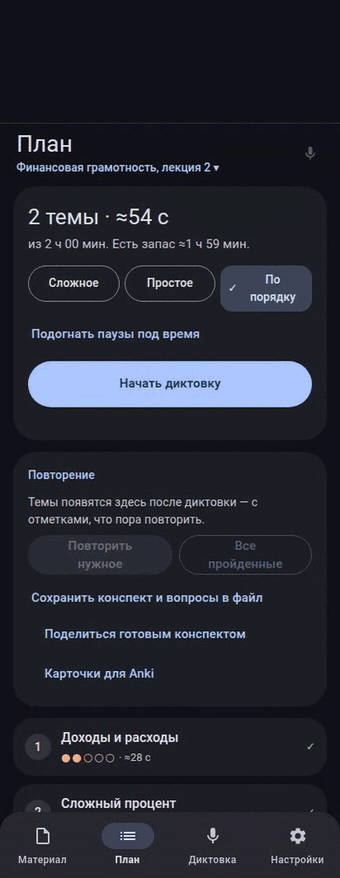
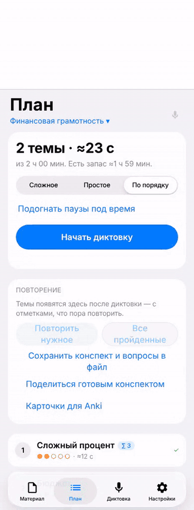
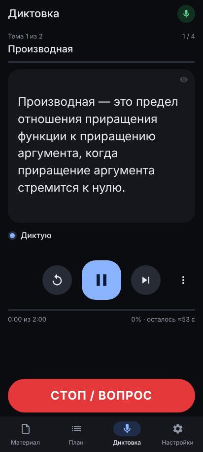
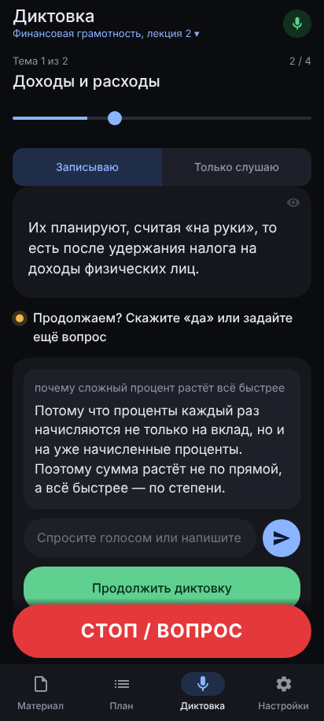
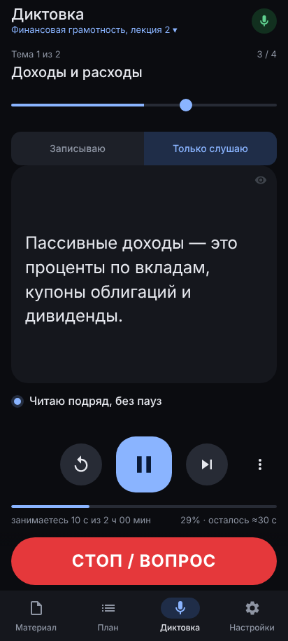
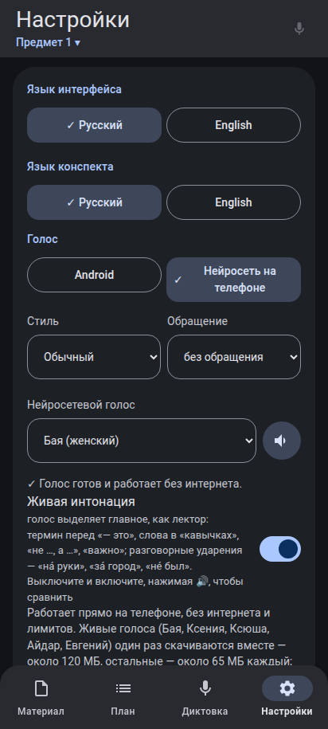
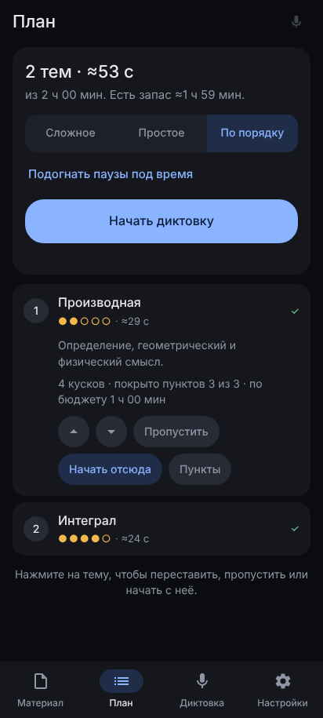
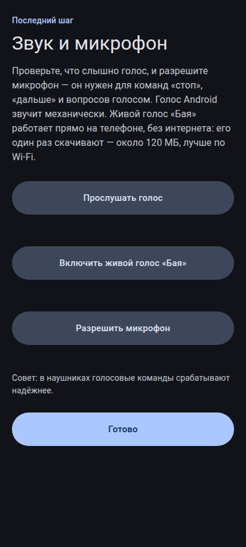

# Диктор конспектов

Мобильное PWA: диктует конспекты голосом короткими отрывками, останавливается по слову «стоп», отвечает на вопросы через нейросеть и продолжает с того же места.

**[▶ Попробовать](https://stairrax.github.io/helper-with-conspects/)**: откройте в Chrome на Android или в Safari на iPhone, ничего устанавливать не нужно.
Понадобится бесплатный ключ [OpenRouter](https://openrouter.ai/keys): мастер при первом запуске проведёт по шагам, это пара минут.

- **Диктует отрывками по 1–3 предложения** с паузой на запись; темы, план и оценка времени — по вашему конспекту (текст, PDF, DOCX, фото страниц) или по **записи лекции**, сделанной прямо на паре.
- **«Стоп» голосом или кнопкой** обрывает речь сразу; можно спросить «почему…», нейросеть ответит с учётом конспекта, и диктовка вернётся к прерванному отрывку.
- **Голосом можно управлять всем**: «перейди к третьей теме», «покажи формулы», «открой план», «паузы подольше», «светлая тема», «сохрани конспект» — или своими словами, нейросеть поймёт.
- **Живой голос прямо на телефоне** (Silero «Бая» и другие): без интернета и лимитов, с ударениями по смыслу и интонацией лектора; числа на экране цифрами, а в голосе — словами.
- **Учиться, а не только записывать**: самопроверка после темы и экзамен по всему предмету, повторение слабых мест с напоминаниями, шпаргалка на одну страницу, карточки для Anki, формулы — отдельным блоком, режим «Только слушаю» для транспорта, статистика занятий.
- **Подстраивается под вас**: паузы сами становятся короче или длиннее под скорость вашего письма, а читаемое слово можно подсвечивать в тексте. На iPhone конспект можно озвучить в MP3 и слушать с погасшим экраном.
- **Готовым конспектом можно поделиться**: одногруппник откроет файл и сразу начнёт диктовку, без своего ключа.
- **Android, iPhone и компьютер** (с клавишами). На Android у приложения свой вид в духе Material You, на iPhone — в стиле iOS; светлый или тёмный вместе с системой. Есть и другие темы: «Классика», «Неон» и светлая «Тетрадь». Интерфейс бывает на русском и на английском, английские конспекты тоже можно диктовать.
- **Данные — только на вашем устройстве**: конспекты и ключ никуда не отправляются, кроме выбранной вами нейросети.

<table>
  <tr>
    <td align="center"></td>
    <td align="center"></td>
  </tr>
  <tr>
    <td align="center">Android, оформление Android: «стоп», вопрос, ответ и продолжение</td>
    <td align="center">iPhone, оформление iOS: «покажи формулы», затем «стоп» и вопрос</td>
  </tr>
</table>

В роликах звук заменён субтитрами: сверху — что говорит диктор и что говорит человек.

  
  
  
  
  
  

**In English:** the app also works fully in English — switch *Settings → Interface language* and *Notes language* to English (on first run both follow your browser language). Notes are dictated with an English voice, and English voice commands work: “stop”, “next”, “repeat”, “go to topic two”, “show formulas”.

## Подробнее

- [Все возможности](docs/features.md): диктовка, голосовые команды, запись лекции, учебные функции, английский язык, голоса, оформление.
- [Настройка и советы](docs/setup.md): первый запуск, какую нейросеть выбрать и где взять ключ, установка на Android и iPhone, язык.
- [Свой хостинг и устройство кода](docs/development.md): как разместить свою копию, структура файлов, автотесты, перевод интерфейса.

## Поддержать проект

Приложение бесплатное и останется таким. Если оно вам помогает, автора можно поддержать на **[Boosty](https://boosty.to/stairrax)** любой суммой. Это добровольно: поддержка ничего не открывает, бесплатная версия ничем не отличается — она и есть единственная.

Ещё можно помочь, не тратя денег: поставить звезду репозиторию, рассказать о приложении одногруппникам или написать в [Issues](https://github.com/Stairrax/helper-with-conspects/issues), что неудобно или сломалось.

## Лицензии

У кода и у моделей разные лицензии:

- **Код приложения** (`index.html`, `css/`, `js/`, `sw.js`, `icons/` и остальное, кроме перечисленного ниже) — [GNU GPL v3](LICENSE) ([кратко по-русски](LICENSE.ru.md)): свободное ПО, его можно использовать, изменять, распространять и продавать, но любая распространяемая версия должна оставаться открытой под той же лицензией. Copyright © 2026 Stairrax.
- **Модель Silero** в [`voices/silero-ru/`](voices/silero-ru/) — © [Silero Team](https://github.com/snakers4/silero-models), [CC BY-NC-SA 4.0](voices/silero-ru/LICENSE): **только некоммерческое использование**, с указанием авторов, производные — на тех же условиях. Коммерческому проекту нужно убрать эту папку или договориться с авторами.
- **Шрифты** Onest, Unbounded и Literata в [`fonts/`](fonts/) — [SIL Open Font License 1.1](fonts/OFL.txt).
- **Голоса Piper** скачиваются по ссылке с Hugging Face (`rhasspy/piper-voices`) и в репозиторий не входят; у каждого голоса своя лицензия — в его карточке модели.
- Библиотеки, которые загружаются с CDN (onnxruntime-web, piper-wasm, pdf.js, mammoth.js, lamejs), — по их собственным лицензиям.
