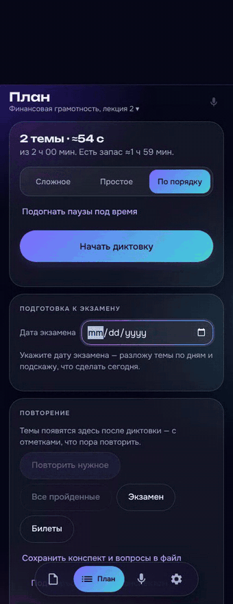
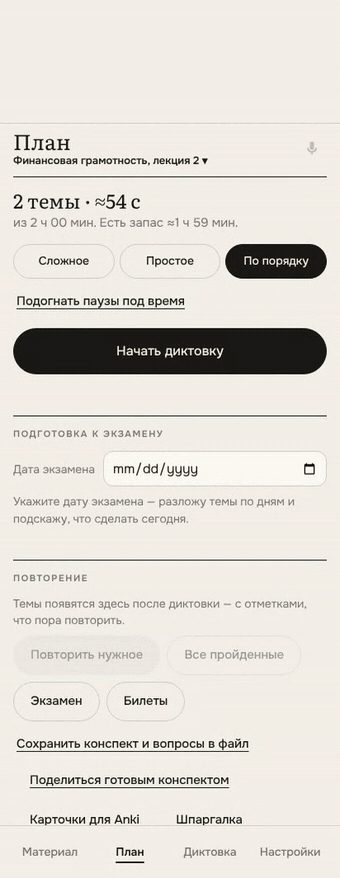
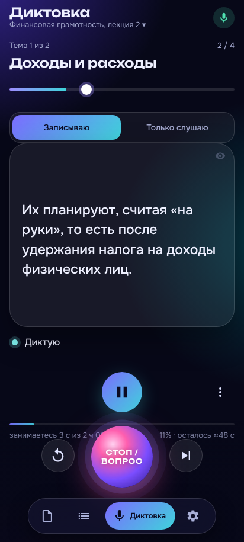
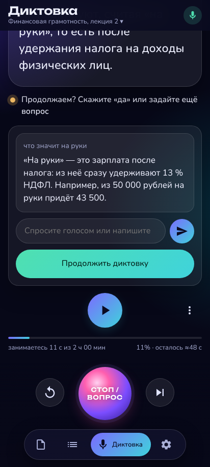
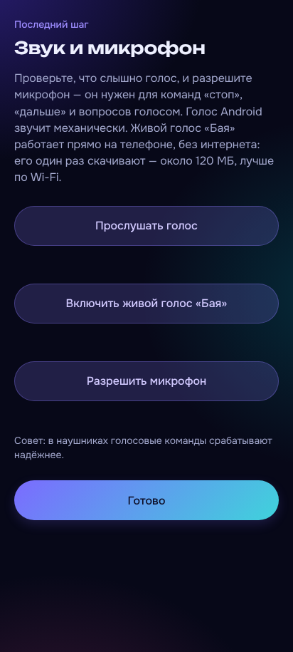
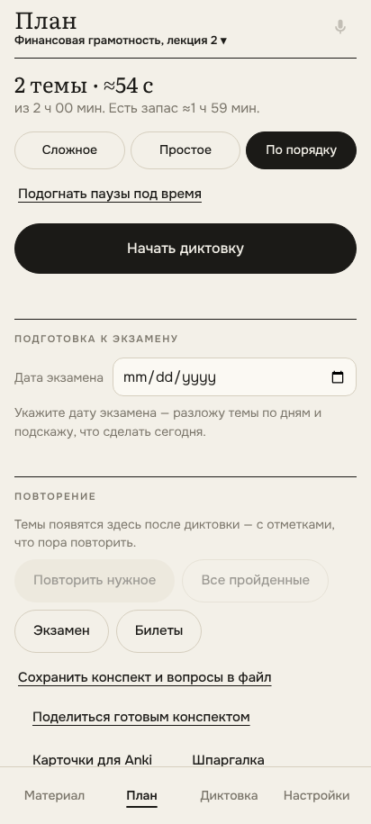
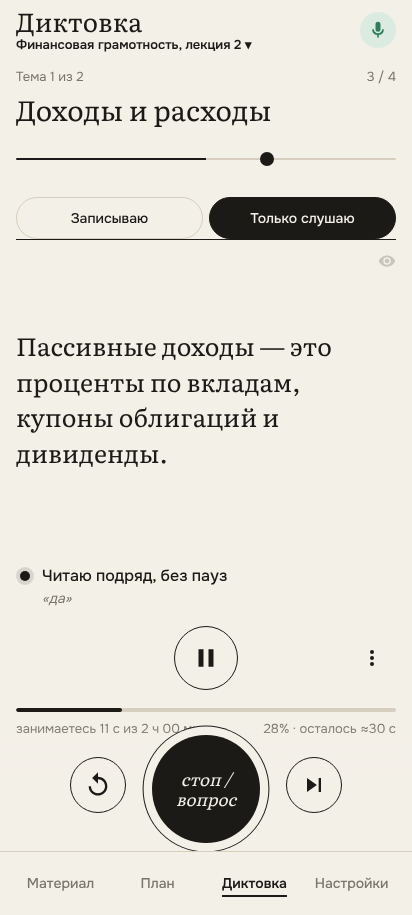
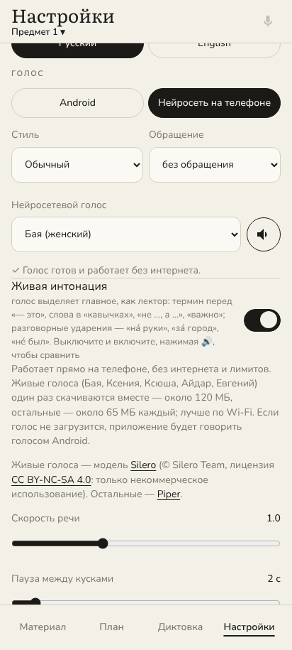

# Помощник по учёбе

Приложение помогает работать с учебными материалами: разбивает их на темы, диктует конспект и отвечает на вопросы по нему. А перед экзаменом можно повторить темы, попробовать ответить на билеты или составить план подготовки.

ИИ может ошибиться в формуле, числе или определении. Проверка полноты — дополнительная оценка, а не доказательство точности: важные фрагменты сверяйте с оригиналом. Сейчас приоритет — надёжность загрузки, подготовки и диктовки материалов. [Что проверено и что ещё предстоит](docs/stability.md).

**[▶ Открыть приложение](https://stairrax.github.io/helper-with-conspects/)** — оно работает в браузере на телефоне и компьютере, установка не обязательна.
Для начала свой ключ не нужен: бесплатный режим использует сервер приложения. Если дневной лимит закончится, можно подключить собственный ключ [OpenRouter](https://openrouter.ai/keys); инструкция есть внутри приложения.

> **В России для работы с нейросетью может понадобиться VPN.** Доступность сервера приложения и OpenRouter зависит от сети. Без соединения с нейросетью нельзя разобрать новый материал на темы, получить ответы и составить задания; готовые конспекты можно диктовать без интернета после загрузки необходимого голоса.
>
> Проверить соединение можно в разделе «Настройки → Проверить связь». О настройке сервера на своём домене написано в [инструкции](server/README.md#из-россии-без-vpn).

- **Диктовка с паузами.** Добавьте текст, PDF, DOCX, фотографии страниц или запишите лекцию. Приложение разобьёт материал на темы и будет диктовать его короткими отрывками, чтобы вы успевали записывать.
- **Вопросы во время диктовки.** Скажите «стоп» или нажмите кнопку, задайте вопрос по материалу и продолжите с того места, где остановились.
- **Голосовые команды** помогают перейти к теме, показать формулы, открыть план или изменить паузы. Например: «перейди к третьей теме» или «покажи формулы».
- **Голоса.** Доступны пять голосов Silero, которые после загрузки работают на устройстве без интернета. Числа при чтении произносятся словами.
- **Подготовка к экзамену.** По конспекту можно создать билеты и тесты, пересказать тему своими словами, получить разбор ответа и составить план подготовки с выгрузкой в календарь.
- **Повторение.** Есть самопроверка, повторение слабых мест, шпаргалка, карточки для Anki и отдельный список формул. В режиме «Только слушаю» удобно повторять материал в дороге; статистика помогает следить за занятиями.
- **Настройки диктовки.** Паузы могут подстраиваться под скорость письма, а читаемое слово — подсвечиваться. На iPhone конспект можно сохранить в MP3 и слушать с погашенным экраном.
- **Обмен конспектами.** Готовый конспект можно отправить одногруппнику: для его диктовки собственный ключ не нужен.
- **Android, iPhone и компьютер** (с клавишами). Два оформления: тёмная «Аврора» со светящейся кнопкой «стоп» и светлые «Чернила» с крупным книжным шрифтом — меняются вместе с темой телефона. Есть и другие: в стиле Android и iOS, «Классика», «Неон», «Тетрадь». Интерфейс бывает на русском и на английском, английские конспекты тоже можно диктовать.
- **Хранение данных**: конспекты и настройки сохраняются на устройстве. Для обработки запросов нужные материалы отправляются выбранному сервису нейросети; в бесплатном режиме запросы проходят через сервер приложения.

<table>
  <tr>
    <td align="center"></td>
    <td align="center"></td>
  </tr>
  <tr>
    <td align="center">«Аврора» (тёмная тема телефона): «стоп», вопрос, ответ</td>
    <td align="center">«Чернила» (светлая тема телефона): то же самое</td>
  </tr>
</table>

В роликах звук заменён субтитрами: сверху — что говорит приложение и что говорит человек.

  
  
  
  
  
  

**In English:** the app also works fully in English — switch *Settings → Interface language* and *Notes language* to English (on first run both follow your browser language). Notes are dictated with an English voice, and English voice commands work: “stop”, “next”, “repeat”, “go to topic two”, “show formulas”.

## Подробнее

- [Все возможности](docs/features.md): диктовка, голосовые команды, запись лекции, учебные функции, английский язык, голоса, оформление.
- [Настройка и советы](docs/setup.md): первый запуск, какую нейросеть выбрать и где взять ключ, установка на Android и iPhone, язык.
- [Свой хостинг и устройство кода](docs/development.md): как разместить свою копию, структура файлов, автотесты, перевод интерфейса.

## Поддержать проект

Приложение бесплатное и останется таким. Если оно вам помогает, автора можно поддержать на **[Boosty](https://boosty.to/stairrax)** любой суммой. Это добровольно: поддержка ничего не открывает, бесплатная версия ничем не отличается — она и есть единственная.

Ещё можно помочь, не тратя денег: поставить звезду репозиторию, рассказать о приложении одногруппникам или написать в [Issues](https://github.com/Stairrax/helper-with-conspects/issues), что неудобно или сломалось.

## Лицензии

У кода и у моделей разные лицензии:

- **Код приложения** (`index.html`, `css/`, `js/`, `sw.js`, `icons/` и остальное, кроме перечисленного ниже) — [GNU GPL v3](LICENSE) ([кратко по-русски](LICENSE.ru.md)): свободное ПО, его можно использовать, изменять, распространять и продавать, но любая распространяемая версия должна оставаться открытой под той же лицензией. Copyright © 2026 Stairrax.
- **Модель Silero** в [`voices/silero-ru/`](voices/silero-ru/) — © [Silero Team](https://github.com/snakers4/silero-models), [CC BY-NC-SA 4.0](voices/silero-ru/LICENSE): **только некоммерческое использование**, с указанием авторов, производные — на тех же условиях. Коммерческому проекту нужно убрать эту папку или договориться с авторами.
- **Шрифты** Nunito, Onest, Unbounded и Literata в [`fonts/`](fonts/) — [SIL Open Font License 1.1](fonts/OFL.txt).
- **Голоса Piper** скачиваются по ссылке с Hugging Face (`rhasspy/piper-voices`) и в репозиторий не входят; у каждого голоса своя лицензия — в его карточке модели.
- Библиотеки, которые загружаются с CDN (onnxruntime-web, piper-wasm, pdf.js, mammoth.js, lamejs), — по их собственным лицензиям.
